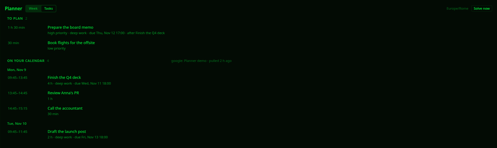
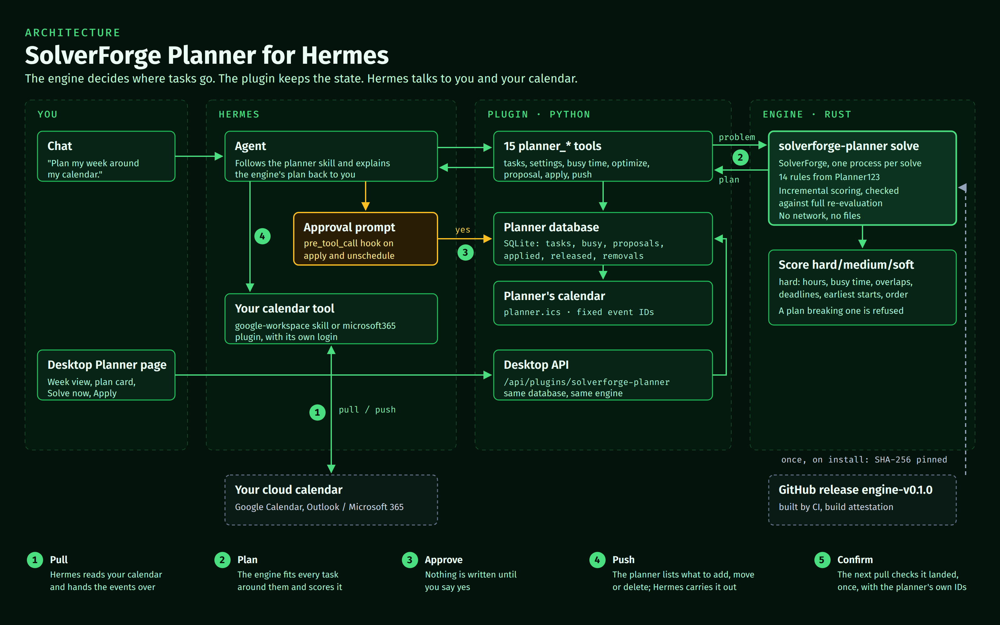

# SolverForge Planner for Hermes

<p align="center"></p>

**Tell Hermes what you need to get done. A constraint solver fits it into your week around your
meetings and deadlines, and proves every hard rule holds before anything goes on your calendar.**


Ask a language model to schedule a week and you get something plausible: a deadline quietly missed,
a task on top of a meeting, work after hours. This plugin gives Hermes a real planner. The
[SolverForge](https://solverforge.org) engine places every task, Hermes explains the result, and a
score of `0hard` is the solver's proof that no hard rule is broken. When something cannot fit, you
are told which task and why.

## Try it

You need [Hermes Agent](https://github.com/NousResearch/hermes-agent) 0.22.2 or newer.

```sh
hermes plugins install blackopsrepl/hermes-solverforge-planner --enable
hermes solverforge-planner install
```

The second command downloads the planning engine for your computer (about 5 MB) and checks it
against a fingerprint pinned in the plugin. There is nothing else to install: no Rust, no database,
no account. Then start Hermes and ask:

> Plan my next week. I work 9 to 6 Monday to Friday, Rome time, and do deep work best 9 to 12.
> Finish the Q4 deck, about 4 hours, by Wednesday 6pm. Review Anna's PR, 1 hour, after the deck.
> Call the accountant, 30 minutes, low priority. Monday 9–12 I'm at an offsite.

Hermes asks for anything it is missing, solves, and shows you the plan. Say "apply" and it goes on
the planner's calendar; say "update my calendar" and it goes on yours.

The planner keeps its own calendar on your computer. Your cloud calendars are optional: Hermes
pulls them in and pushes the plan out with the calendar tool you already use
([Google Calendar or Microsoft 365](#your-calendar)). The planner itself holds no calendar login.

If you already use Hermes, run `hermes chat -q hi` once after installing, then ask. Current Hermes
builds a session's tool list from the plugins it saw at the previous launch, so the session right
after an install has no planner tools.

**In the Desktop app**, open **Capabilities → Plugins** and turn on SolverForge Planner's Desktop
features. You get the plan card above, a **Planner** page in the sidebar, and the engine install as
a button there.

## What you can ask

| You say | What the planner does |
| --- | --- |
| "Plan my week", "fit these in before Friday" | Creates the tasks and solves them into free working time |
| "must be done by Wednesday 6pm" | Hard deadline: never missed, or you are told it can't be met |
| "ideally by Thursday" | Soft deadline: met when possible, lateness kept as small as possible |
| "only after the deck is done" | Task order, always respected |
| "not before Monday" | Earliest start |
| "deep work 9 to 12" | Focus window: demanding work goes there first |
| "I'm out Thursday", "the review takes 2 hours" | Updates what it knows and solves again |
| "apply" | Puts the plan on the planner's calendar, after you approve it |
| "pull my calendar" | Copies your cloud calendar in, as busy time |
| "update my calendar" | Pushes the plan to your cloud calendar: adds, moves and removes only the planner's events |

Busy time comes from [your calendar](#your-calendar), which Hermes pulls before every plan. You
can also hand it an iCalendar file or link, or tell it when you're away.

## What you get

**A plan you can trust.** Working hours, meetings, deadlines, task order and earliest starts are
hard rules, and the score reads `0hard` only when every one of them holds. After that the solver
places as much as it can, most important first, keeps soft deadlines, then keeps demanding work in
your focus window and gives you a break after it.

**Nothing written without you.** Putting blocks on the plan, or taking one off, goes through
Hermes's approval prompt, which lists the exact blocks. Approving one plan never approves a later
one. Your Hermes approval setting decides whether you are asked: with approvals on, writes in
unattended runs (scheduled jobs, `hermes chat -q`) are refused; with approvals off, Hermes doesn't
ask.

**Planned around what is already there.** Once Hermes has pulled a calendar for the planner, the
planner refuses to plan on a pull older than 15 minutes, or one that doesn't cover the whole
planning window. Hermes can't skip the calendar, even by mistake. Recurring meetings count as each
of their occurrences.

**Plans that can't go stale.** A plan remembers what it was solved from. If a task or your settings
change before you apply it, applying is refused and Hermes solves again. A meeting in the latest
pull that overlaps a block stops the apply. A meeting that lands on a block already on your plan is
a clash: the Planner page marks it and offers **Re-plan**, and nothing reaches your cloud calendar
before a push, which needs a fresh pull.

**On your calendar, never twice.** A push lists exactly which of the planner's events to add to your
cloud calendar and which to remove; Hermes makes those changes with your calendar tool and pulls
again, and the planner confirms each one. Every block has a fixed event id and a marker in its
description, so the planner recognizes its own events in every pull. Pushing twice, or after a
dropped connection, never adds an event twice: until a pull shows what arrived, the planner hands
nothing out again. Your own events are never changed. Drag a planned event in your calendar app
and its block moves with it; delete one there and its task goes back to the inbox.

**Any calendar app.** The planner's calendar is also a file, `planner.ics` in the plugin folder,
rewritten on every change, which calendar apps on your computer can subscribe to. Every apply also
gives you an `.ics` file; importing it again updates the same events instead of adding copies.

**In the Desktop app:**


- the plan card in the chat, with the score, your busy time, the proposed blocks and **Apply**;
- a **Planner** page that opens on your week: every pulled calendar in its own colour, with how old
  the copy is, every block already on your plan, and a pending proposal over them with **Apply**.
  Overlapping events sit side by side; a double-booking is marked amber, a meeting on a planned
  block red, with **Re-plan**. Days outside the last pull are marked, never shown as free, and the
  page says how many changes wait to be pushed. **Solve now** sits beside it.
  Pull and push are Hermes's, not buttons: the page can't reach your calendar tool, so it shows
  where things stand and leaves the asking to you;
- a **Tasks** tab: what is waiting for a plan, with what shapes its placement (deadline, priority,
  task order); what is on your calendar, day by day, with how old each pulled copy is; and blocks
  that have ended, folded away;
- a status-bar chip for a plan waiting for approval, or for your next planned block;
- palette commands *Planner: open* and *Planner: solve now*.



**Apply** asks first, listing every block:


**In any chat**, including messaging apps, `/planner` gives you the same controls:

```
/planner status        is the engine installed, what is missing
/planner inbox         tasks not yet on the calendar
/planner plan          solve now and show the proposal
/planner show [id]     show a proposal (default: the latest)
/planner apply <id>    put that proposal on the planner's calendar
/planner install       install the engine
```

**Every morning**, if you like: `/blueprint solverforge-planner:morning` sets up a workday job that
refreshes your busy time, solves the next days and sends you the proposal to approve.

## Your calendar

The planner reads and writes no cloud calendar itself. Hermes does, with the calendar tool you
already use, and the planner checks every pull and works out every push.

| Calendar | Tool for Hermes |
| --- | --- |
| Google Calendar | the bundled **google-workspace** skill: ask Hermes to set up Google Workspace, once |
| Outlook / Microsoft 365 | the [`microsoft365`](https://github.com/fabiomotta0311/hermes-microsoft365-plugin) plugin |
| anything else | hand Hermes an `.ics` export, or tell it your busy times; subscribe your calendar app to `planner.ics` |

Then ask Hermes to plan: it pulls your calendar first. After an apply, say "update my calendar" to
push. Pushes go to the one calendar you have pulled, or to `publish_calendar` when you pull more
than one; a calendar of its own, such as "Planner", keeps the blocks easy to show, hide or
delete. For a Google calendar other than your main one, give Hermes its Calendar ID (Google
Calendar settings → the calendar → *Integrate calendar*). If you don't use a cloud calendar,
nothing is required: the planner plans on its own calendar, around what you tell it.

## Settings

Working hours, focus windows, how far ahead to plan and how long to solve are planner settings:
tell Hermes and it changes them. Two plugin settings live under
**Settings → Plugins → SolverForge Planner** (`plugins.entries.solverforge-planner.settings`):

| Key | Default | Meaning |
| --- | --- | --- |
| `binary` | empty | Use this engine binary instead of the installed one (development) |
| `solve_timeout` | `120` | Seconds before a solve is stopped |

## What it downloads, runs and stores

- **One download, only when you ask for it.** `hermes solverforge-planner install`,
  `/planner install` or the Desktop **Install engine** button fetches
  `solverforge-planner-<platform>` from this repository's
  [`engine-v0.1.0` release](https://github.com/blackopsrepl/hermes-solverforge-planner/releases/tag/engine-v0.1.0)
  and refuses it unless its SHA-256 matches the value pinned in [`engine_bin.py`](engine_bin.py).
  The agent cannot start it. Every binary is built by this repository's
  [release workflow](.github/workflows/release.yml) and carries a GitHub build attestation you can
  check with `gh attestation verify <file> --repo blackopsrepl/hermes-solverforge-planner`.
- **One program, once per solve.** The engine runs as `solverforge-planner solve`: the problem goes
  in as JSON on standard input, the plan comes out on standard output, and it is stopped at
  `solve_timeout`. It makes no network calls. Nothing else is executed.
- **Two Python libraries.** [icalendar](https://pypi.org/project/icalendar/) and
  [recurring-ical-events](https://pypi.org/project/recurring-ical-events/) read `.ics` files, with
  recurring events expanded. Hermes asks before installing them with the plugin.
- **One network call you start.** Loading busy time from an iCalendar link you give Hermes fetches
  that link (up to 10 MB). Your calendar is read and written by your calendar tool, under its own
  login and its own disclosures, never by this plugin.
- **One folder.** Everything is in `<hermes home>/plugin-data/solverforge-planner/`: the planner
  database, the engine, `planner.ics` and the exported `.ics` files. Removing the plugin keeps it, so a reinstall
  finds your tasks; delete the folder to erase them. No credentials are read or stored, and there is
  no telemetry.

Engine builds: Linux (x86_64, arm64), macOS (Apple silicon, Intel), Windows (x86_64).

## How it works



- [`engine/`](engine) is a Rust crate: a stateless SolverForge planning model. Its planning domain
  and all fourteen scoring rules come from [Planner123](https://github.com/blackopsrepl/Planner123)
  unchanged; on the same week, both produce identical plans with the same score. Every rule is
  scored incrementally, and a test checks the incremental score against a full re-evaluation.
- Before a plan is returned, each task's penalties are reconciled with SolverForge's own score
  analysis, and a plan that breaks a hard rule is refused rather than shown.
- The Python plugin keeps the state, translates between Hermes and the engine, gates every write and
  serves the Desktop half. It makes no scheduling decisions.

Score format `hard/medium/soft`, closer to zero is better:

| Level | Counts |
| --- | --- |
| hard | working hours, busy time, overlaps, hard deadlines, earliest starts, task order |
| medium | tasks left unplaced (weighted by priority), lateness past soft deadlines |
| soft | minutes of work outside its focus window, missing breaks after demanding work |

## Development

```sh
make setup        # check Rust 1.95+, uv and Hermes
make check        # full gate: rustfmt, clippy, engine tests, plugin tests, hermes validate + doctor
make install-dev  # install this checkout into Hermes with a locally built engine
make dist-all     # cross-build every release binary on Linux with cargo-zigbuild
make              # all targets
```

The plugin tests drive the real engine through the real tool handlers. The calendar tests play the
agent: they pull calendars and carry out pushes the way the Google Calendar and Microsoft Graph
APIs do (one keeps the event id it is given, the other assigns its own), and check that no event is
ever created twice, even after a dropped connection, that stale pulls are refused, that moves and
deletions made in the calendar app are adopted, and that existing events never change. A fixture
covers recurrence exceptions, moved occurrences, Windows time zone names, and free and cancelled
events. Only the engine download is faked. Engine releases are tagged `engine-vX.Y.Z`; the
plugin pins their checksums before its own `vX.Y.Z` tag.

## License

[Apache-2.0](LICENSE). Copyright 2026 Vittorio Distefano.
