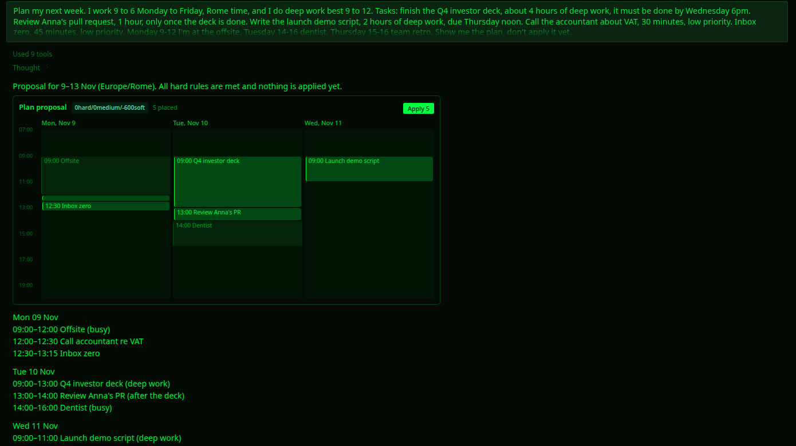
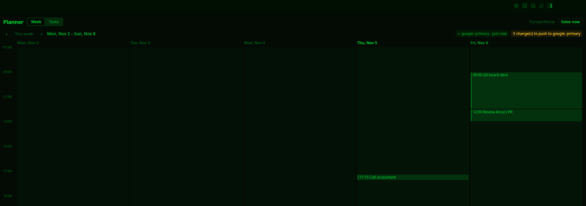
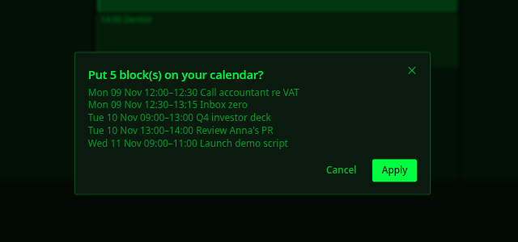

# SolverForge Planner for Hermes

**Tell Hermes what you need to get done. A constraint solver fits it into your week around your
meetings and deadlines, and proves every hard rule holds before anything goes on your calendar.**



Ask a language model to schedule a week and you get something plausible: a deadline quietly missed,
a task on top of a meeting, work after hours. This plugin gives Hermes a real planner. The
[SolverForge](https://solverforge.org) engine places every task, Hermes explains the result, and a
score of `0hard` is the solver's proof that no hard rule is broken. When something cannot fit, you
are told which task and why.

## Try it

You need [Hermes Agent](https://github.com/NousResearch/hermes-agent) 0.22.2 or newer.

```sh
hermes plugins install blackopsrepl/hermes-solverforge-planner --enable
hermes solverforge-planner install
```

The second command downloads the planning engine for your computer (about 5 MB) and checks it
against a fingerprint pinned in the plugin. There is nothing else to install: no Rust, no database,
no account. Then start Hermes and ask:

> Plan my next week. I work 9 to 6 Monday to Friday, Rome time, and do deep work best 9 to 12.
> Finish the Q4 deck, about 4 hours, by Wednesday 6pm. Review Anna's PR, 1 hour, after the deck.
> Call the accountant, 30 minutes, low priority. Monday 9–12 I'm at an offsite.

Hermes asks for anything it is missing, solves, and shows you the plan. Say "apply" and it goes on
your calendar.

If you already use Hermes, the planner's tools appear from the second session after installing:
current Hermes builds a session's tool list from the plugins it saw at the previous launch. In that
first session Hermes tells you to start a new one instead of guessing a schedule.

**In the Desktop app**, open **Capabilities → Plugins** and turn on SolverForge Planner's Desktop
features. You get the plan card above, a **Planner** page in the sidebar, and the engine install as
a button there.

## What you can ask

| You say | What the planner does |
| --- | --- |
| "Plan my week", "fit these in before Friday" | Creates the tasks and solves them into free working time |
| "must be done by Wednesday 6pm" | Hard deadline: never missed, or you are told it can't be met |
| "ideally by Thursday" | Soft deadline: met when possible, lateness kept as small as possible |
| "only after the deck is done" | Task order, always respected |
| "not before Monday" | Earliest start |
| "deep work 9 to 12" | Focus window: demanding work goes there first |
| "I'm out Thursday", "the review takes 2 hours" | Updates what it knows and solves again |
| "apply" | Puts the plan on your calendar, after you approve it |

Busy time comes from wherever your calendar already lives. If Hermes can read it (for example with the
bundled Google Workspace skill), it passes your events to the planner. You can also give it an
iCalendar link or file, or list your meetings in the chat.

## What you get

**A plan you can trust.** Working hours, meetings, deadlines, task order and earliest starts are
hard rules, and the score reads `0hard` only when every one of them holds. After that the solver
places as much as it can, most important first, keeps soft deadlines, then keeps demanding work in
your focus window and gives you a break after it.

**Nothing written without you.** Putting blocks on the calendar, or taking one off, goes through
Hermes's approval prompt, which lists the exact blocks. Approving one plan never approves a later
one. Your Hermes approval setting decides whether you are asked: with approvals on, writes in
unattended runs (scheduled jobs, `hermes chat -q`) are refused; with approvals off, Hermes doesn't
ask.

**Plans that can't go stale.** A plan remembers what it was solved from. If a task, your busy time
or your settings change before you apply it, applying is refused and Hermes solves again.

**Your calendar, any calendar.** Applied blocks are written to an `.ics` file Hermes hands you, which
Google Calendar, Apple Calendar, Outlook and others import. If Hermes has a tool for your calendar,
it offers to add them there directly.

**In the Desktop app:**



- the plan card in the chat, with the score, your busy time, the proposed blocks and **Apply**;
- a **Planner** page with the latest proposal, your tasks and **Solve now**;
- a status-bar chip for a plan waiting for approval, or for your next planned block;
- palette commands *Planner: open* and *Planner: solve now*.

**Apply** asks first, listing every block:



**In any chat**, including messaging apps, `/planner` gives you the same controls:

```
/planner status        is the engine installed, what is missing
/planner inbox         tasks not yet on the calendar
/planner plan          solve now and show the proposal
/planner show [id]     show a proposal (default: the latest)
/planner apply <id>    put that proposal on the calendar
/planner install       install the engine
```

**Every morning**, if you like: `/blueprint solverforge-planner:morning` sets up a workday job that
refreshes your busy time, solves the next days and sends you the proposal to approve.

## Settings

Working hours, focus windows, how far ahead to plan and how long to solve are planner settings:
tell Hermes and it changes them. Two plugin settings live under
**Settings → Plugins → SolverForge Planner** (`plugins.entries.solverforge-planner.settings`):

| Key | Default | Meaning |
| --- | --- | --- |
| `binary` | empty | Use this engine binary instead of the installed one (development) |
| `solve_timeout` | `120` | Seconds before a solve is stopped |

## What it downloads, runs and stores

- **One download, only when you ask for it.** `hermes solverforge-planner install`,
  `/planner install` or the Desktop **Install engine** button fetches
  `solverforge-planner-<platform>` from this repository's
  [`engine-v0.1.0` release](https://github.com/blackopsrepl/hermes-solverforge-planner/releases/tag/engine-v0.1.0)
  and refuses it unless its SHA-256 matches the value pinned in [`engine_bin.py`](engine_bin.py).
  The agent cannot start it. Every binary is built by this repository's
  [release workflow](.github/workflows/release.yml) and carries a GitHub build attestation you can
  check with `gh attestation verify <file> --repo blackopsrepl/hermes-solverforge-planner`.
- **One program, once per solve.** The engine runs as `solverforge-planner solve`: the problem goes
  in as JSON on standard input, the plan comes out on standard output, and it is stopped at
  `solve_timeout`. It makes no network calls. Nothing else is executed.
- **One network call you start.** Loading busy time from an iCalendar URL fetches that URL (up to
  10 MB).
- **One folder.** Everything is in `<hermes home>/plugin-data/solverforge-planner/`: the planner
  database, the engine and the exported `.ics` files. Removing the plugin keeps it, so a reinstall
  finds your tasks; delete the folder to erase them. No credentials are read or stored, and there is
  no telemetry.

Engine builds: Linux (x86_64, arm64), macOS (Apple silicon, Intel), Windows (x86_64).

## How it works

```
you ──► Hermes ──► planner_* tools ──► planner database ──► problem (JSON)
                     │                                          │
                     │                  solverforge-planner solve (Rust, SolverForge)
                     │                                          │
                     └─ approval prompt ──► apply ◄────── proposal (JSON)
Desktop ──► /api/plugins/solverforge-planner ──► same database and engine
```

- [`engine/`](engine) is a Rust crate: a stateless SolverForge planning model. Its planning domain
  and all fourteen scoring rules come from [Planner123](https://github.com/blackopsrepl/Planner123)
  unchanged; on the same week, both produce identical plans with the same score. Every rule is
  scored incrementally, and a test checks the incremental score against a full re-evaluation.
- Before a plan is returned, each task's penalties are reconciled with SolverForge's own score
  analysis, and a plan that breaks a hard rule is refused rather than shown.
- The Python plugin keeps the state, translates between Hermes and the engine, gates every write and
  serves the Desktop half. It makes no scheduling decisions.

Score format `hard/medium/soft`, closer to zero is better:

| Level | Counts |
| --- | --- |
| hard | working hours, busy time, overlaps, hard deadlines, earliest starts, task order |
| medium | tasks left unplaced (weighted by priority), lateness past soft deadlines |
| soft | minutes of work outside its focus window, missing breaks after demanding work |

## Development

```sh
make setup        # check Rust 1.95+, uv and Hermes
make check        # full gate: rustfmt, clippy, engine tests, plugin tests, hermes validate + doctor
make install-dev  # install this checkout into Hermes with a locally built engine
make dist-all     # cross-build every release binary on Linux with cargo-zigbuild
make              # all targets
```

The plugin tests drive the real engine through the real tool handlers. Only the network is faked,
in the test that proves a wrong checksum is refused. Engine releases are tagged `engine-vX.Y.Z`; the
plugin pins their checksums before its own `vX.Y.Z` tag.

## License

[Apache-2.0](LICENSE). Copyright 2026 Vittorio Distefano.
